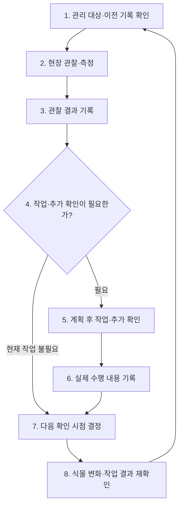

# 호접란 농민의 재배일지 활용 프로세스

작성일: 2026-11-01  
성격: 앞선 재배 조사와 일지 목적을 연결한 현장 검토용 업무 프로세스 초안. 실제 농가의 업무 순서·역할·판정 기준은 추가 확인이 필요하다.

## 1. 업무 목표

**어느 재배 대상에 어떤 변화가 있었고, 왜 어떤 작업을 했으며, 이후 어떻게 달라졌는지 남겨 다음 관리와 출하를 판단한다.**

일지는 현장 관찰과 작업 실적을 모아 다시 보는 기록이다. 오늘 할 일은 계획이며 실제 수행 여부·결과와 구분한다. 관찰만 하고 작업하지 않은 날에도 기록을 남길 수 있어야 한다.

## 2. 전체 재배 흐름

재배 목표·출하 규격 설정 → 묘 입고·재배 배치 등록 → 단계별 일상 관리 반복 → 출하 적합성 판단 → 선별·출하 → 결과 평가 → 다음 재배계획에 반영.

호접란의 관리 단계는 입고·순화/활착, 영양생장, 개화 유도, 꽃대·봉오리 발달, 개화·출하 준비로 나누어 검토한다. 중묘나 성숙묘를 입고하는 농가는 입고 당시 단계에서 시작한다. 날짜 경과만으로 단계를 자동 전환하지 않는다.

## 3. 반복되는 일상 관리 흐름

### 단계별 역할과 기록

| 단계 | 농민이 하는 일 | 일지에 남길 내용 | 다음 판단 |
|---|---|---|---|
| 1. 대상·이전 기록 확인 | 온실·구역·품종·배치를 고르고 최근 작업·미해결 사항·환경 이력 확인 | 기본 대상 정보는 재사용. 이번 확인 대상·시점 구분 | 오늘 무엇을 우선 확인할 것인가? |
| 2. 관찰·측정 | 잎·뿌리·꽃대·봉오리와 배지·설비를 현재 단계에 맞게 확인 | 조사 시각·표본·측정값·사진·관찰 범위 | 이전과 어떤 차이가 있는가? |
| 3. 관찰 기록 | 관찰 사실을 저장하고 미확정 사항 구분 | 정상/이상이라는 결론만 쓰지 않고 구체적인 변화 기록 | 작업·분석·전문가 확인이 필요한가? |
| 4. 판단 | 이전 기록·단계별 기준과 비교하여 유지·추가 확인·작업 결정 | 판단 이유, 원인 후보, 미확정 여부 | 무엇을 언제 누가 할 것인가? |
| 5. 계획·실행 | 필요한 작업 또는 추가 조사를 계획·수행 | 예정 대상·기한·담당자. 실제 실행 전에는 완료로 표시하지 않음 | 계획대로 수행되었는가? |
| 6. 실적 기록 | 실제 수행 내용·양·시간·변경사항 저장 | 관수·시비·유인·검사 등 실제 내용, 미실시·부분 수행·대상 변경 | 어떤 결과를 언제 확인할 것인가? |
| 7. 후속 확인 설정 | 작업과 변화 속도에 맞게 다음 확인 시점 결정 | 확인 예정일·담당자·확인 항목 | 재확인 누락 방지 |
| 8. 재확인 | 가능하면 같은 표본·방법으로 다시 관찰 | 변화·추가 증상·검사 결과, 해결/관찰 지속/추가 대응 | 현재 관리 유지·수정 또는 추가 상담 |

작업을 하지 않기로 한 판단과 관찰 지속도 유효한 결과다. 원인을 모르는 경우에는 원인 미확정으로 기록하고 필요한 추가 확인을 연결한다. 단일 환경값이나 사진만으로 진단·작업을 자동 확정하지 않는다.

## 4. 한 번의 기록을 연결하는 최소 단위

| 구분 | 기록할 내용 |
|---|---|
| 어디에·무엇을 | 온실·구역·베드, 품종·입고/재배 배치, 필요시 표본 주·잎·꽃대 ID |
| 언제·누가 | 관찰/실제 작업 시각, 입력 시각, 담당자 |
| 어떤 상태였나 | 관찰 사실·측정값·사진·조사 주수·현재 관리 단계 |
| 왜 결정했나 | 관리 기준·이전 기록과의 차이·판단 이유·미확정 사항 |
| 무엇을 했나 | 실제 작업 내용·사용 자재·양·시간·미실시·변경사항 |
| 이후 어떻게 됐나 | 재확인 시점·항목·관찰 결과·후속 조치 |

온실 전체 작업과 특정 배치·베드 작업을 구분한다. 서로 다른 위치로 이동한 배치도 이전 환경·작업 기록을 잃지 않도록 이동 이력을 연결한다.

## 5. 호접란 사례 — 가상의 업무 흐름

| 순서 | 상황·행동 | 기록의 쓰임 |
|---|---|---|
| 대상 확인 | C동·호접란 3차 배치의 이전 관수·시비·생육 기록을 조회 | 어느 집단의 문제인지 특정 |
| 관찰 | 일부 주에서 새뿌리 끝 마름을 발견하고 위치·표본·사진을 기록 | 발견 사실 보존 |
| 판단 | 원인을 확정하지 않고 배지 수분·수태 배치·급액 및 배지 검사 이력을 확인하기로 결정 | 판단 근거와 미확정 사항 보존 |
| 실행 | 의심주 표시와 추가 측정·검사 의뢰를 실시 | 실제 수행과 계획을 구분 |
| 후속 확인 | 검사 결과와 정한 시점의 뿌리 상태를 이전 기록과 비교 | 대응 유지·수정·추가 상담 판단 |

가상 사례이며 특정 비료·관수·방제 처방을 제안하는 내용은 아니다.

## 6. 출하 때 일지를 어떻게 활용하는가

1. 해당 배치의 꽃대·봉오리·개화·외관을 납품 규격과 비교한다.
2. 출하 가능·보류·제외 수량과 사유를 구분한다. 한 배치를 나눠 출하해도 이력을 유지한다.
3. 실제 출하일·대상·규격·수량·판매 결과를 남긴다. 재배 주수와 합식 상품 수·상자 수를 구분한다.
4. 반품·손상 등 후속 결과가 있으면 원래 배치에 연결한다.
5. 품종·배치별 관리 기간·작업·자재·품질·불량 결과를 비교해 다음 계획에 반영한다. 기록 간 연관만으로 인과관계가 입증되었다고 하지 않는다.

## 7. 서비스에서 지원할 역할

- 농민: 현장 확인, 관리 판단, 작업 수행, 실제 결과 확인.
- 시스템: 대상·시각 재사용, 환경·관찰·작업·출하 기록 연결, 계획과 실적 구분, 미해결 사항·후속 확인 표시.
- 담당자 공유: 누가 어느 구역에 무엇을 했는지 확인. 작업자와 판단자가 다르면 각각 남김.

‘오늘 할 일’에서 실제 작업 내용을 저장하면 같은 기록이 일지에서 조회되도록 설계한다. 관찰은 작업 없이도 저장한다. 센서 데이터는 자동 수집된 환경 이력으로 연결하며 농민이 확인한 생육 기록과 출처를 구분한다.

관련 상세 근거: [분화 호접란 재배 점검표](floriculture-phalaenopsis-cultivation-checklist-2026-11-01.md).
