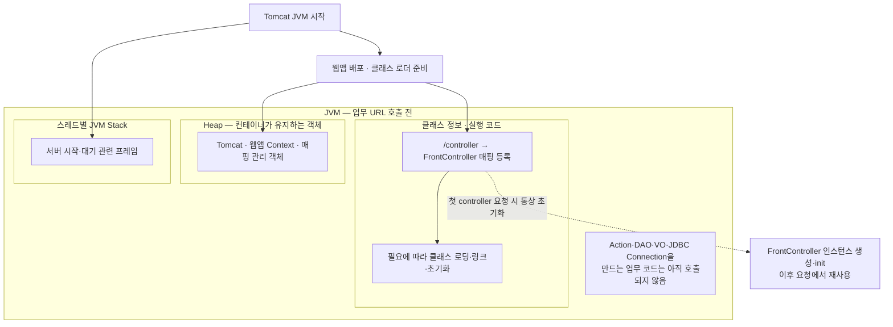
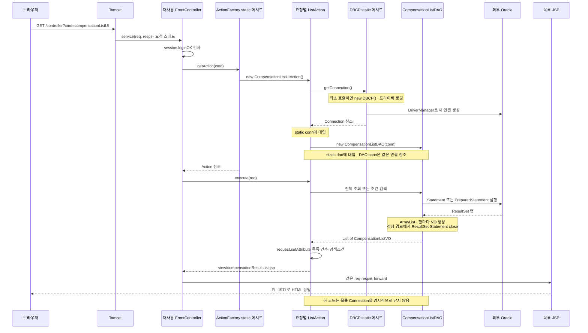
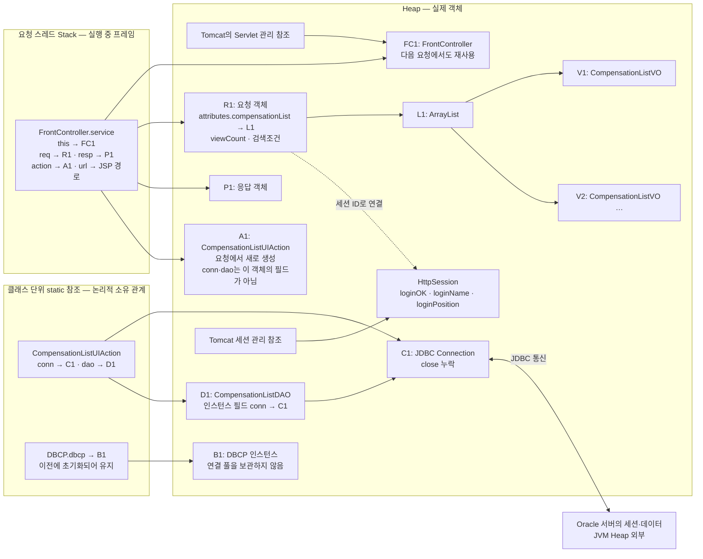
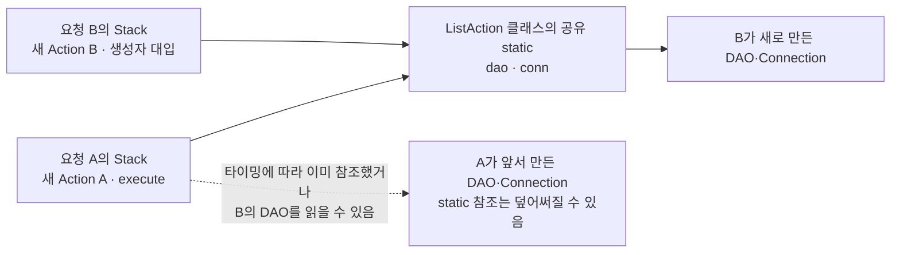

# 1차 스프린트 메모리 그림 — 서버 실행과 주소 호출

기준: 2026-10-18 원격 갱신 후 `origin/main` / `f9c9a43aba6563ae6b9f4617cdb83f6f96300f3f`. `origin/dev`도 같은 파일 트리다.

이 그림은 **최신 소스로부터 재구성한 객체·참조·생명주기 그림**이다. 실제 서버의 heap dump나 메모리 주소 측정 결과는 아니다. JIT 최적화·컨테이너 내부 객체·JDBC 내부 객체는 생략했다. 전체 리뷰는 [최신 Git 리뷰](sprint1-latest-review.md)를 참고한다.

## 1. 서버 실행 기준 — 업무 요청을 받기 전

Tomcat을 실행하면 컨테이너가 웹앱을 배포하고 `@WebServlet("/controller")` 매핑을 등록한다. 이 프로젝트는 `loadOnStartup`을 지정하지 않았다. 기본값은 -1이며, 그림은 별도 선행 로딩 설정이 없는 지연 초기화 기준이다. 실제 배포 설정·사전 JSP 컴파일 여부는 소스만으로 확정할 수 없다. [WebServlet API](https://tomcat.apache.org/tomcat-9.0-doc/servletapi/javax/servlet/annotation/WebServlet.html#loadOnStartup--)

서버 시작만으로 `new CompensationListUIAction()`이나 `DBCP.getConnection()`이 실행되지는 않는다. 앱에는 이를 선행 실행하는 Listener나 초기화 코드가 없다. Controller도 자체 init에서 DAO·Action을 만들지 않는다. 최초 HTTP 요청은 index/main의 이동을 거쳐 Controller에 도달할 수 있지만, 그 과정은 아래 주소 호출 단계다.

| 구분 | 이 프로젝트에 적용할 설명 |
| --- | --- |
| `.class` 파일 | 배포된 프로그램 파일. 클래스 정보가 로딩되는 것과 인스턴스 생성은 다르다. |
| 클래스 정보·메서드 코드 | JVM의 method area 관점으로 설명한다. 구현의 Metaspace와 완전히 동일한 말로 단정하지 않는다. |
| Heap | 실제 Servlet·Action·DAO·VO·String·배열·세션 등의 객체를 표시한다. |
| 스레드별 Stack | 실행 중인 메서드 프레임, 지역 변수·참조·중간 계산을 표시한다. |
| static 필드 | 같은 클래스 로더의 클래스 단위 공유 참조로 별도 표시한다. 아래 칸은 소유 관계 표기이며 물리 주소 구역의 단정이 아니다. |

JVM은 Heap을 공유하고 스택은 스레드별로 가진다. 객체·배열은 Heap 모델에, 메서드 호출의 프레임은 스택 모델에 그린다. 구체 물리 배치는 JVM 구현에 맡겨져 있다. [JVMS 2.5–2.6](https://docs.oracle.com/javase/specs/jvms/se17/html/jvms-2.html#jvms-2.5)

DBCP 클래스가 초기화됐다면 `dbcp`의 초기값은 null이다. `new DBCP()`는 최초 `getConnection()`에서 실행된다. 목록·로그인 Action의 static `conn`·`dao`도 해당 클래스가 초기화된 직후에는 null이며 **생성자 본문에서** 실제 객체 참조로 대입된다. 모든 클래스를 서버 시작 순간에 이미 초기화한 것으로 그리지 않는다. [JLS 12.4](https://docs.oracle.com/javase/specs/jls/se17/html/jls-12.html#jls-12.4.1)

`Query`는 SQL 문자열의 상수 인터페이스다. 객체가 없으며 컴파일 타임 String 상수의 참조는 인터페이스 초기화를 유발하지 않을 수 있다. `ActionFactory.getAction()`과 `PrivacyMaskingUtil.maskName()`도 static 메서드여서 그 메서드를 호출하기 위해 Factory·유틸 인스턴스를 만들지 않는다.

## 2. 주소 호출 기준 — 목록 요청의 객체 생성 순서

아래 `{base}`는 `http(s)://호스트:포트/실제-context-path`다. README의 과거 이름이나 로컬 폴더 이름만으로 현재 배포 주소를 확정할 수 없다.

대표 URL: `{base}/controller?cmd=compensationListUI`. 세션에 `loginOK`가 있다고 가정한다. 비로그인이면 Action 생성 전 로그인 화면으로 redirect된다.

Action 생성자 실행은 `getAction()`이 반환되기 **전**이다. 따라서 DB 접속 오류는 `execute()` 이전에도 발생한다. 현재 Factory는 그 SQLException을 catch하고 null을 반환할 수 있다.

## 3. 주소 호출 기준 — 목록 JSP로 forward하기 직전의 메모리

시점: `action.execute(req)`가 반환되고 Controller가 forward를 호출하기 직전. Factory·생성자·DAO·execute 프레임은 이미 반환됐다. 진행 중 프레임과 이미 종료한 프레임을 한 스택에 동시에 놓지 않는다.

`new CompensationListDAO(conn)`은 Connection을 복사하거나 새 DB 접속을 만들지 않는다. 같은 C1 참조를 생성자 인자로 전달하고 DAO의 인스턴스 필드에 저장한다. 반면 `static dao`는 **DAO를 가리키는 참조의 소유자가 클래스**라는 뜻이다. DAO 객체 자체는 Heap에 있다.

DAO 실행 도중의 스택을 그릴 때는 `service → execute → getCompensationList/searchCompensationList` 프레임을 추가하고, DAO 프레임의 `list`, `stmt/pstmt`, `rs`, `vo` 참조를 Heap 객체에 연결한다. 이때는 아직 `request.setAttribute("compensationList", ...)`를 실행하기 전이므로 request에서 목록으로 화살표를 미리 그리지 않는다.

## 4. 나머지 주소를 호출할 때의 차이

| 주소·동작 | 새로 생성·참조하는 객체 | 반환 뒤 유지·정리 |
| --- | --- | --- |
| `GET /controller?cmd=qualityOfficerLoginUI` | `new QualityOfficerLoginUI()`. DB 접근 없음. 로그인 JSP forward | Action은 요청에서만 사용. Action은 세션을 직접 만들지 않지만 JSP 기본 session 설정에 따라 미인증 HttpSession이 생길 수 있다. `loginOK`가 있는 인증 상태와 구분한다. |
| `POST /controller?cmd=qualityOfficerLoginAction` | `new QualityOfficerLoginAction()` 생성자에서 새 연결, 사용하지 않는 목록 DAO도 생성. execute에서 `new QualityOfficerDAO(conn)`과 로그인 VO 생성 | 성공 시 세션에 VO 전체 대신 `loginOK/loginName/loginPosition` 값을 보관. 실패는 request의 loginError와 로그인 JSP. static 연결은 close 누락. |
| 로그인 성공 후 redirect | Controller가 302를 보내 브라우저가 목록을 새 요청 | 이전 request 속성은 새 request로 넘어가지 않음. 세션은 세션 ID로 이어짐. |
| `GET /controller?cmd=compensationListUI&...` | 위 목록 그림. 검색이면 StringBuilder·PreparedStatement·조건값 추가 | request 속성으로 목록·건수·검색조건을 JSP에 전달. static DAO/Connection은 남음. |
| `GET /controller?cmd=compensationDetailAction&appId=...` | `new compensationDetailAction()`. execute 지역 변수의 Connection·상세 DAO·구역별 VO·문서 List 생성 | try-with-resources가 Connection close. 조회한 VO/List는 request가 계속 참조하므로 JSP 출력 가능. |
| appId 비어 있음/조회 대상 없음 | 비어 있으면 DB 연결 전 목록 redirect, 요약/보상신청 없음이면 연결 후 목록 redirect | 후자의 경우에도 try-with-resources의 close 수행. DAO가 삼킨 SQL 오류는 정상 없음과 섞일 수 있음. |
| `GET /controller?cmd=qualityOfficerLogout` | 로그아웃 Action이 기존 HttpSession을 얻어 invalidate | 기존 세션을 무효화하고 로그인 JSP forward. Action의 static JDBC 연결을 해제하는 동작은 없음. |
| 직접 `/view/*.jsp` | Controller·Factory·Action 호출을 건너뜀. JSP 처리 경로 | Controller의 로그인 검사와 DAO 조회는 실행되지 않음. 직접 JSP 보호는 명시된 2차 과제. |

로그인·목록의 `static conn/dao`는 **각 클래스마다 별개**다. 로그인과 목록이 하나의 공통 static 변수를 공유하는 것으로 합쳐 그리지 않는다. 같은 종류의 요청들끼리는 해당 클래스의 static 변수를 공유한다.

## 5. 동시 요청과 종료 시점까지 그리기

실제 경합 발생을 부하 테스트한 그림은 아니다. `new Action`이 요청별이라는 사실만으로 내부 static 상태까지 요청별이 되지는 않는다는 소스상의 공유 관계를 표현했다. 한 요청의 DAO 참조를 읽는 시점에 따라 서로 다른 요청이 같은 DAO·Connection을 사용할 가능성이 있다.

응답 후에는 요청 처리 프레임이 반환된다. 컨테이너는 request/response를 재활용할 수 있으므로 “즉시 객체가 파괴된다”고 그리지 않는다. 다른 참조가 사라진 요청 결과·Action은 GC 대상이 될 수 있지만 실제 수거 시점은 보장되지 않는다. 세션 값은 세션 무효화·만료 등까지, 클래스의 static 참조는 재대입·웹앱 해제 등까지 유지될 수 있다. JDBC 연결은 GC와 별도로 `close()`가 필요한 외부 자원이다.

상세 조회는 Connection을 닫은 뒤에도 VO를 출력할 수 있다. VO는 ResultSet의 살아 있는 행을 붙잡은 객체가 아니라, `getString/getInt/getDate`로 읽은 값을 생성자·필드에 담은 객체이기 때문이다.

## 6. 소스 없이 직접 그릴 때의 점검 질문

1. 서버만 시작했을 때 업무 Action/DAO/Connection은 생성됐는가? 무엇이 URL 매핑을 보관하는가?
2. Servlet 객체와 `service()` 프레임은 누가 만들며 각각 얼마나 유지되는가?
3. Factory 객체·Action 인터페이스 객체·Query 객체를 그릴 필요가 있는가?
4. `new Action` 생성자는 `getAction()` 반환 전인가 후인가?
5. 지역 변수 `dao`, DAO의 인스턴스 필드 `conn`, Action의 static 필드 `dao/conn`은 각각 어디를 가리키는가?
6. `execute()`가 반환되면 지역 변수 프레임은 사라지는데 JSP가 목록을 읽을 수 있는 이유는 무엇인가?
7. forward와 redirect에서 request·response·세션의 생명주기는 어떻게 달라지는가?
8. 상세와 목록에서 Connection 해제 책임은 어떻게 다른가? 로그아웃은 목록 연결까지 닫는가?

공식 규칙과 프로젝트 소스에서 확인한 추론을 함께 사용했다. 실제 로딩 시점·메모리 할당을 실측하려면 동일 SHA로 Tomcat을 실행하고 해당 URL 순서에 맞춰 디버거 또는 메모리 프로파일러로 별도 확인해야 한다.
